# Vivaminima · small tools for Claude Code

We run a small company where each department is a Claude Code window. These are the tools we wrote after our own windows broke something: a key left in a ZIP, a skill that never loaded, a note that went missing between windows.

- **Small.** Most are one Python file, standard library only. Nothing to install.
- **Local.** They read your folders and write a report. Only the budget router talks to the network, to the LLM provider you call.
- **Free and MIT** in these repositories. Most have a **Pro edition ($19, one-time)** with more checks and reports, on our store: https://vivastory4.gumroad.com

## Before you ship or share a folder

<table>
<tr><td width="50%" valign="top"><a href="https://github.com/vivaminima/release-gate">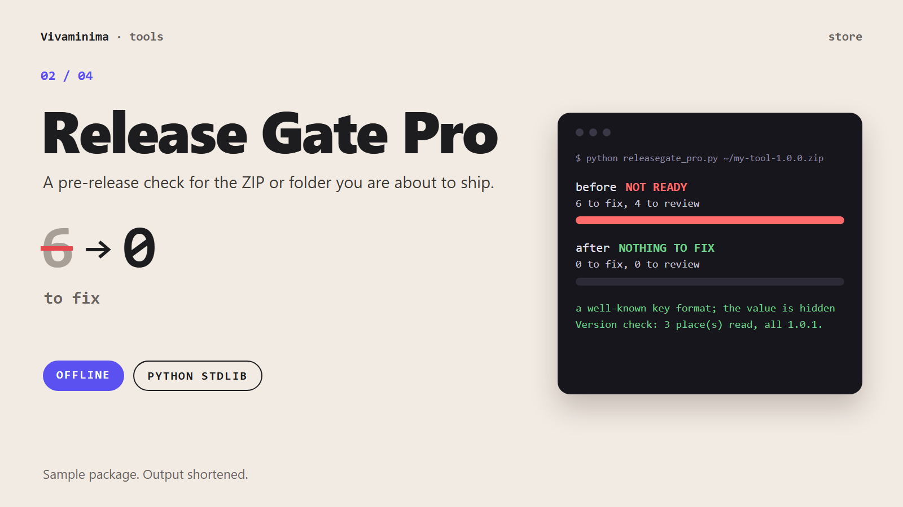</a> <b><a href="https://github.com/vivaminima/release-gate">release-gate</a></b> · free A pre-release check for the ZIP or folder you are about to ship: keys, stray files, machine paths, version mismatches. Pro: <a href="https://vivastory4.gumroad.com/l/release-gate-pro">Release Gate Pro</a> ($19)</td><td width="50%" valign="top"><a href="https://github.com/vivaminima/secret-map">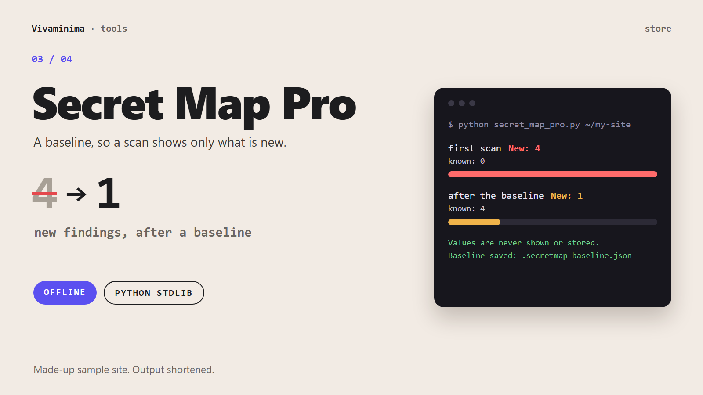</a> <b><a href="https://github.com/vivaminima/secret-map">secret-map</a></b> · free See where API keys and passwords sit in a folder before you share it. Shows locations, never values. Pro: <a href="https://vivastory4.gumroad.com/l/secret-map-pro">Secret Map Pro</a> ($19)</td></tr>
<tr><td width="50%" valign="top"><a href="https://github.com/vivaminima/console-safe">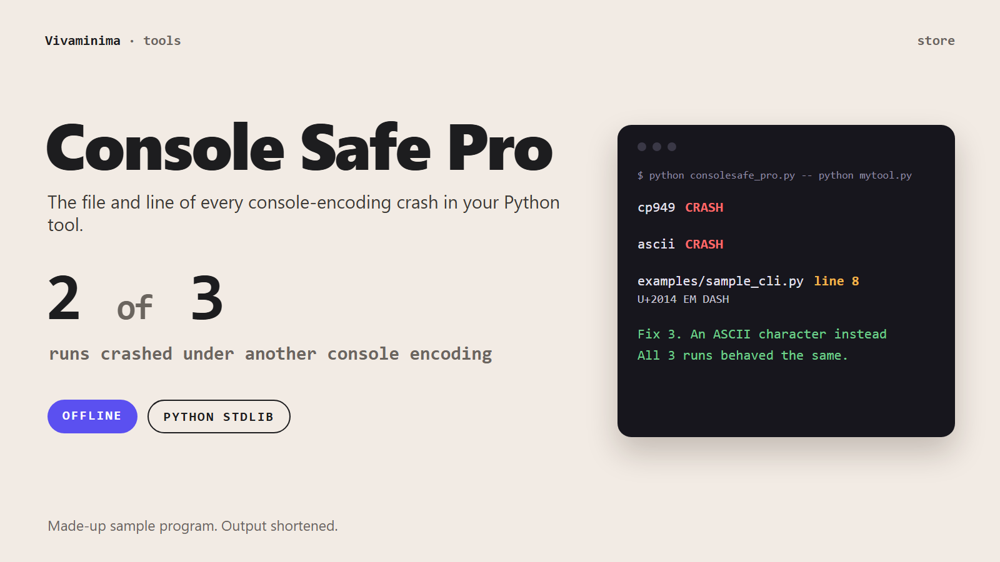</a> <b><a href="https://github.com/vivaminima/console-safe">console-safe</a></b> · free Run a Python command-line tool under several console encodings and see where it dies. Pro: Console Safe Pro, coming soon</td></tr>
</table>

## Claude Code skills

<table>
<tr><td width="50%" valign="top"><a href="https://github.com/vivaminima/skill-audit-kit">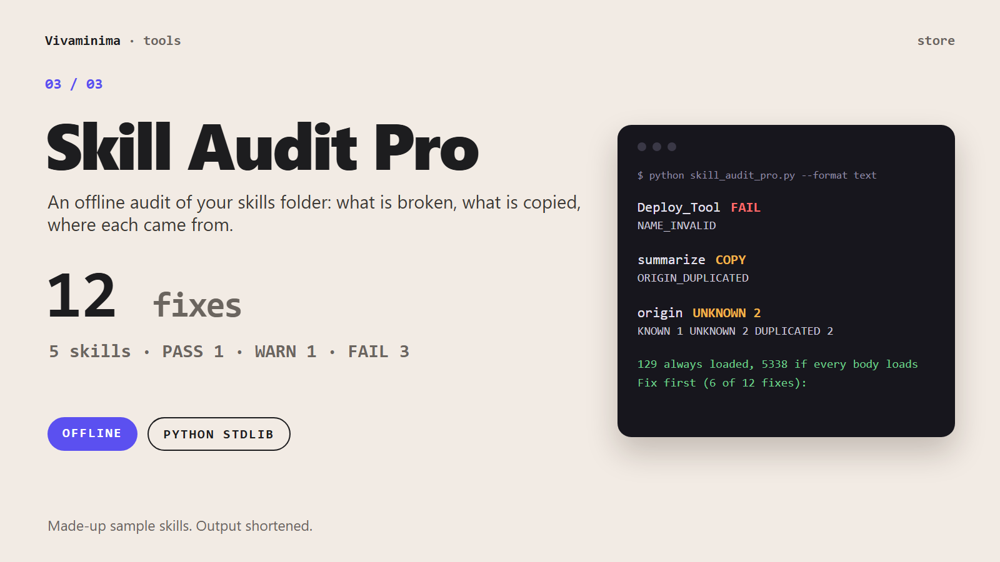</a> <b><a href="https://github.com/vivaminima/skill-audit-kit">skill-audit-kit</a></b> · free Find out why a Claude skill does not load, does not trigger, or eats your context. Read-only. Pro: <a href="https://vivastory4.gumroad.com/l/skill-audit-pro">Skill Audit Pro</a> ($19)</td><td width="50%" valign="top"><a href="https://github.com/vivaminima/skill-install-gate">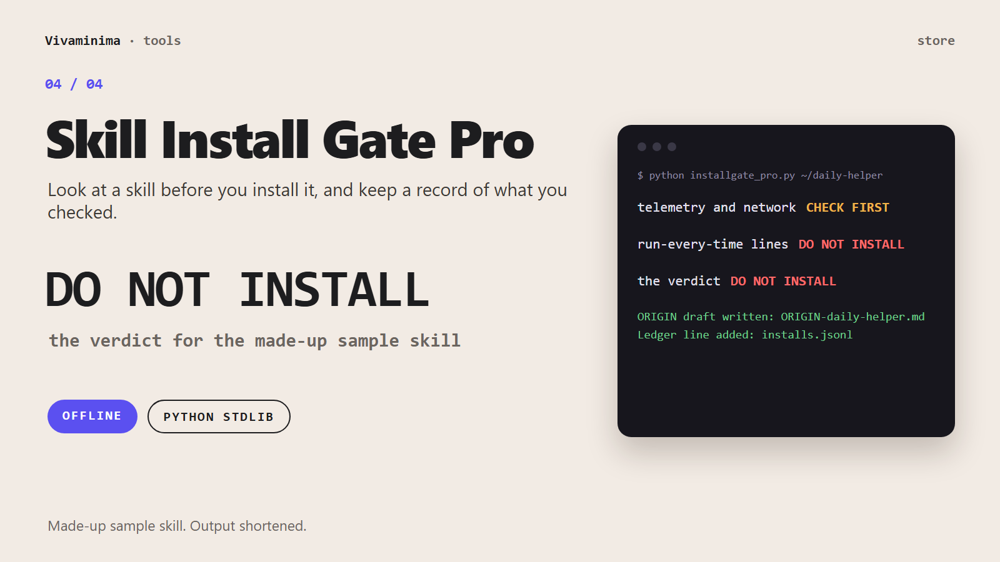</a> <b><a href="https://github.com/vivaminima/skill-install-gate">skill-install-gate</a></b> · free Look at a Claude Code skill before you install it: a check of a temporary copy with one of three verdicts. Pro: <a href="https://vivastory4.gumroad.com/l/skill-install-gate-pro">Skill Install Gate Pro</a> ($19)</td></tr>
<tr><td width="50%" valign="top"><b><a href="https://github.com/vivaminima/beginner-readme-section">beginner-readme-section</a></b> · free A Claude Code skill that writes a "New to this? Start here" section at the top of a README. Free only</td></tr>
</table>

## Running several Claude windows

<table>
<tr><td width="50%" valign="top"><a href="https://github.com/vivaminima/inbox-ledger">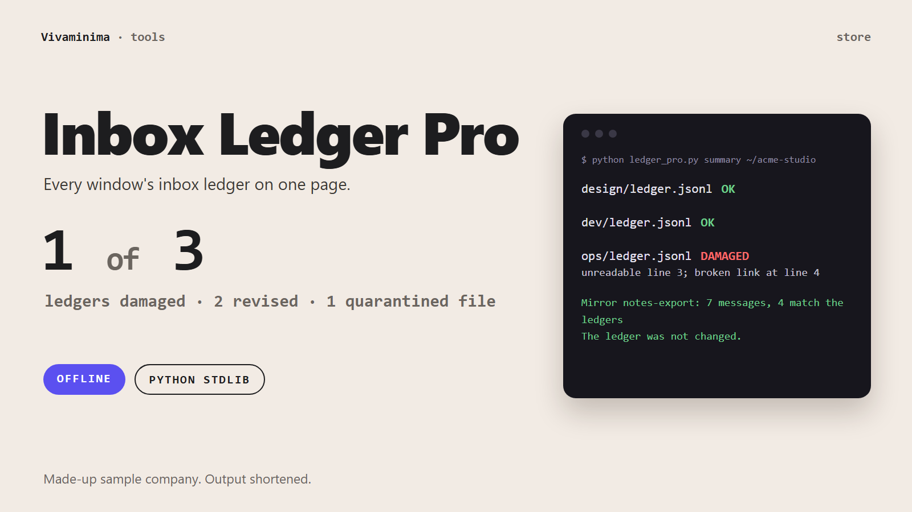</a> <b><a href="https://github.com/vivaminima/inbox-ledger">inbox-ledger</a></b> · free A receipt book for the folder your Claude windows use to pass notes: nothing counted twice, nothing lost. Pro: <a href="https://vivastory4.gumroad.com/l/inbox-ledger-pro">Inbox Ledger Pro</a> ($19)</td><td width="50%" valign="top"><a href="https://github.com/vivaminima/handoff-check">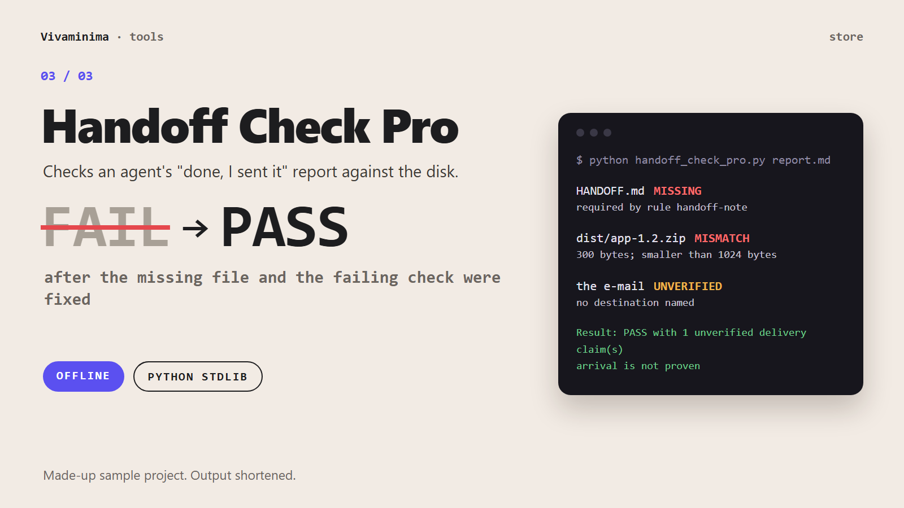</a> <b><a href="https://github.com/vivaminima/handoff-check">handoff-check</a></b> · free Checks an agent's "done, I sent it" report against the disk and writes a verification receipt. Pro: <a href="https://vivastory4.gumroad.com/l/handoff-check-pro">Handoff Check Pro</a> ($19)</td></tr>
<tr><td width="50%" valign="top"><a href="https://github.com/vivaminima/checklist-stop">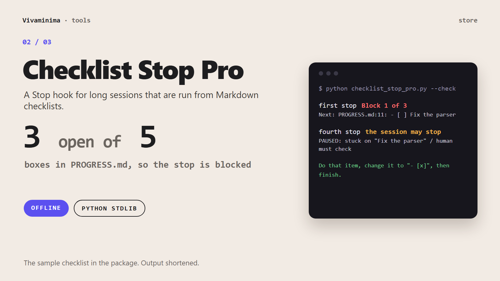</a> <b><a href="https://github.com/vivaminima/checklist-stop">checklist-stop</a></b> · free A Stop hook for Claude Code: the session cannot finish while your Markdown checklist still has an open item. Pro: <a href="https://vivastory4.gumroad.com/l/checklist-stop-pro">Checklist Stop Pro</a> ($19)</td><td width="50%" valign="top"><a href="https://github.com/vivaminima/ai-company-starter-kit">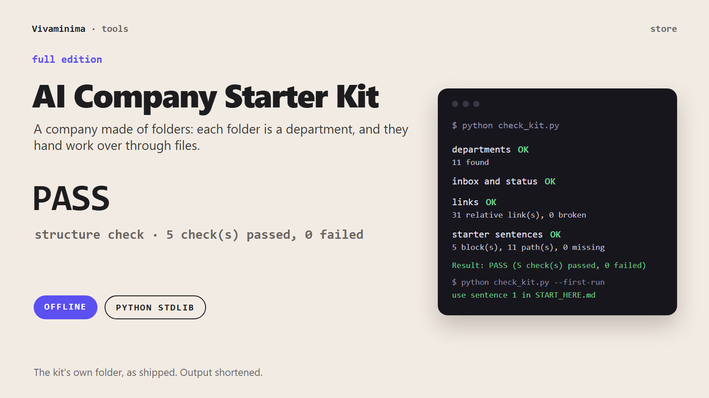</a> <b><a href="https://github.com/vivaminima/ai-company-starter-kit">ai-company-starter-kit</a></b> · free A sample company made of folders: each folder is a department, each Claude window works as one. Pro: <a href="https://vivastory4.gumroad.com/l/ai-company-starter-kit">AI Company Starter Kit (full edition)</a> ($19)</td></tr>
</table>

## Context, cost and decisions

<table>
<tr><td width="50%" valign="top"><a href="https://github.com/vivaminima/context-file-audit">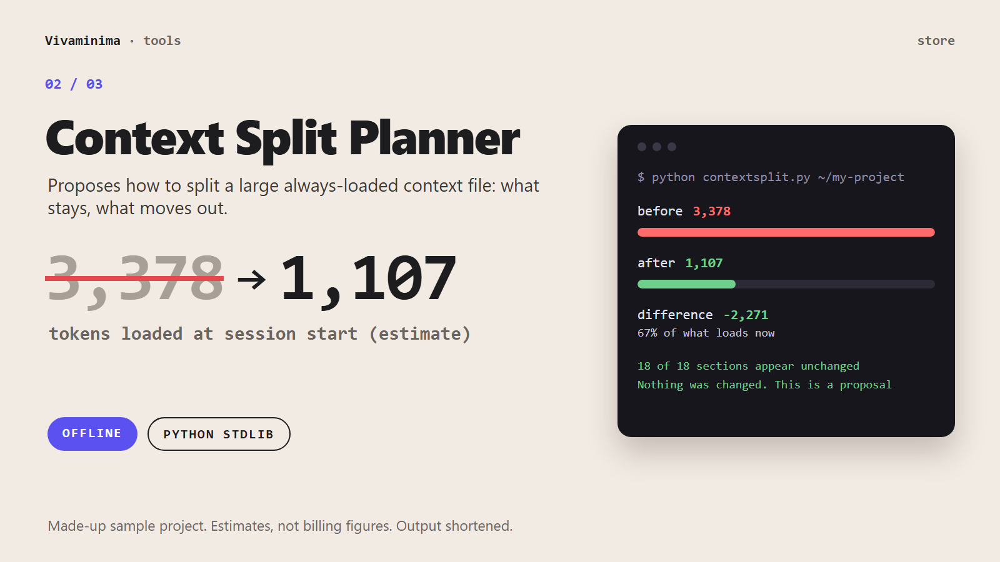</a> <b><a href="https://github.com/vivaminima/context-file-audit">context-file-audit</a></b> · free Measure what your CLAUDE.md and its @imports cost at session start. Pro: Context Split Planner, coming soon</td><td width="50%" valign="top"><a href="https://github.com/vivaminima/llm-budget-router-lite">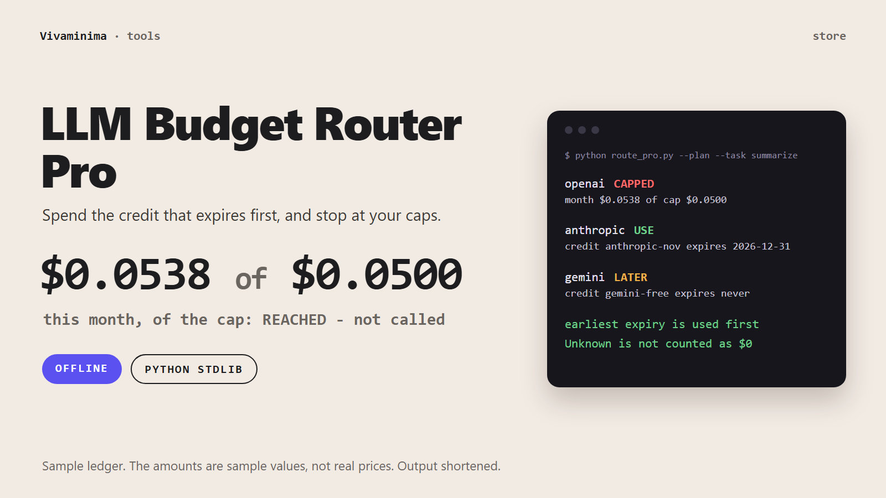</a> <b><a href="https://github.com/vivaminima/llm-budget-router-lite">llm-budget-router-lite</a></b> · free Route LLM requests and see what each call costs. One local Python file, standard library only. Pro: <a href="https://vivastory4.gumroad.com/l/llm-budget-router-pro">LLM Budget Router Pro</a> ($19)</td></tr>
<tr><td width="50%" valign="top"><a href="https://github.com/vivaminima/go-no-go-verdict-skill">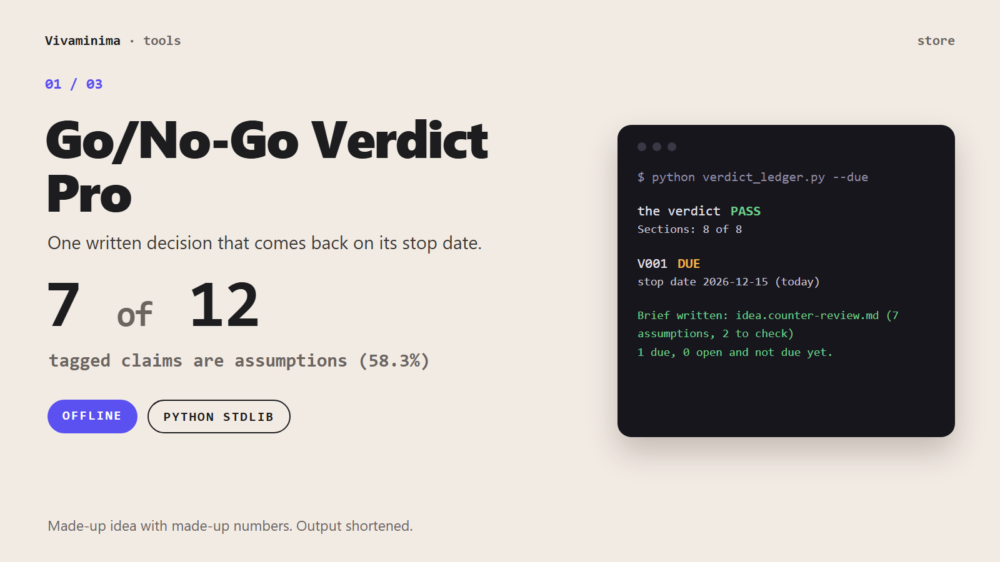</a> <b><a href="https://github.com/vivaminima/go-no-go-verdict-skill">go-no-go-verdict-skill</a></b> · free Turn one idea into a decision with explicit assumptions and stop conditions. A Claude Code skill and a small checker. Pro: <a href="https://vivastory4.gumroad.com/l/go-no-go-verdict-pro">Go/No-Go Verdict Pro</a> ($19)</td></tr>
</table>

---

Questions or a broken check? Open an issue in the tool's repository.
